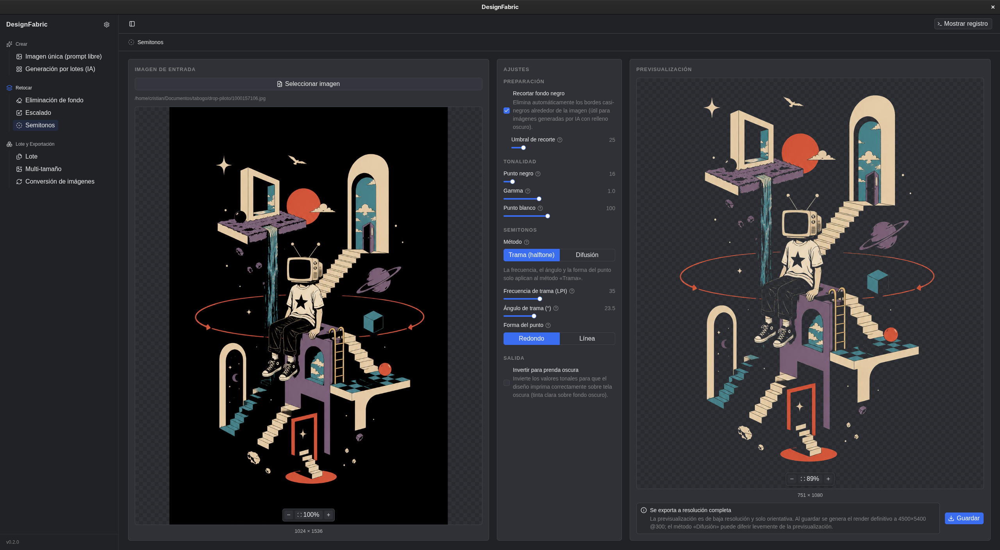

# DesignFabric

**Aplicación de escritorio para generación de diseños de camisetas impulsada por IA.**

DesignFabric es un monorepo que fusiona dos proyectos anteriores — **ClearCut** (eliminación de fondos y escalado) y **DesignFabric** (generación de stickers mediante Ollama + FLUX.2 Klein)— en una única aplicación de escritorio Electron respaldada por un backend FastAPI unificado. Todas las herramientas se encuentran como pestañas dentro de una única interfaz, organizadas según la etapa del flujo de trabajo.

Diseñado para flujos de trabajo de impresión bajo demanda (print-on-demand) y stickers DTF (Direct to Film).

---

## Capturas de pantalla



---

## Funcionalidades

### Crear

| Herramienta                          | Descripción                                                                                                                                          |
| ------------------------------------ | ---------------------------------------------------------------------------------------------------------------------------------------------------- |
| **Imagen individual (prompt libre)** | Genera un único sticker mediante IA a partir de un prompt de texto libre usando Ollama + FLUX.2 Klein. Admite OpenRouter como proveedor alternativo. |
| **Generación por lotes (IA)**        | Genera múltiples stickers simultáneamente a partir de una lista de prompts, con seguimiento del progreso y cancelación cooperativa.                  |

### Retoque

| Herramienta              | Descripción                                                                                                                                                                                                                                                                  |
| ------------------------ | ---------------------------------------------------------------------------------------------------------------------------------------------------------------------------------------------------------------------------------------------------------------------------- |
| **Eliminación de fondo** | Elimina fondos de imágenes utilizando una de 6 estrategias: OpenCV clásico (fondos blancos/de color), SAM2+ViTMatte (neuronal, bordes suaves), IS-Net General (neuronal, bordes definidos), rembg Illustration (anime/arte 2D) o BiRefNet+SAM2+Matte (pipeline multimodelo). |
| **Escalado**             | Escala imágenes utilizando Real-ESRGAN x4 General v3 mediante ONNX en CPU.                                                                                                                                                                                                   |
| **Semitono (Halftone)**  | Convierte imágenes a versiones de semitono para impresión bajo demanda / serigrafía. Admite difusión de Floyd-Steinberg y dithering ordenado con frecuencia, ángulo y forma de punto configurables. Salida: PNG transparente de 4500x5400 a 300 DPI.                         |

### Procesamiento por lotes y exportación

| Herramienta                          | Descripción                                                                                                                                                                                            |
| ------------------------------------ | ------------------------------------------------------------------------------------------------------------------------------------------------------------------------------------------------------ |
| **Procesamiento por lotes**          | Aplica eliminación de fondo + escalado a múltiples archivos simultáneamente, con información del progreso y tolerancia a fallos parciales.                                                             |
| **Exportación en múltiples tamaños** | Exporta imágenes en múltiples tamaños (en píxeles fijos o basados en porcentajes), cada uno como un archivo separado, empaquetados en un `.zip` descargable. Incluye presets de tamaños reutilizables. |
| **Conversión de imágenes**           | Convierte entre JPEG, JPG, PNG y WEBP con control de calidad, opción WEBP sin pérdida y aplanamiento de transparencias para JPEG. Admite modos individual y por lotes.                                 |

### Funcionalidades adicionales

* **Pegar y arrastrar y soltar**: Pega imágenes desde el portapapeles (Ctrl+V) o arrástralas y suéltalas sobre la entrada de cualquier herramienta de retoque/utilidad. Admite PNG, JPEG y WEBP mediante validación de *magic bytes*.

* **Enviar a**: Menú contextual mediante clic derecho sobre cualquier resultado para transferirlo como entrada a otra herramienta (por ejemplo, enviar directamente una imagen a la que se le eliminó el fondo hacia la herramienta de escalado).

* **Consola de logs en tiempo real**: Logs del backend y del proceso principal integrados en la interfaz y mostrados en tiempo real.

* **Ventana de configuración**: Gestión de la API key de OpenRouter (cifrada mediante `safeStorage`), selectores de modelos, instalación de módulos de IA locales y configuración de rutas de modelos ONNX.

* **CLIs independientes**: Utiliza `clearcut` y `designfabric` desde la terminal sin necesidad de ejecutar la aplicación de escritorio.

---

## Stack tecnológico

### Escritorio

| Capa        | Tecnología                              |
| ----------- | --------------------------------------- |
| Runtime     | Electron 43.1.1                         |
| Build       | electron-vite 3.1.0                     |
| UI          | React 19 + TypeScript 5.8               |
| Estilos     | Tailwind CSS 4 + shadcn/Radix UI        |
| Estado      | Zustand (persistencia de formularios)   |
| Datos       | TanStack React Query                    |
| Empaquetado | electron-builder (`.AppImage` / `.exe`) |

### Backend

| Capa                      | Tecnología                                             |
| ------------------------- | ------------------------------------------------------ |
| Framework                 | FastAPI + Uvicorn (puerto 8756)                        |
| Procesamiento de imágenes | OpenCV, Pillow, NumPy                                  |
| Inferencia neuronal       | ONNX Runtime (SAM2, ViTMatte, IS-Net, Real-ESRGAN)     |
| Generación mediante IA    | PyTorch + CUDA, Diffusers (FLUX.2 Klein), Transformers |
| LLM                       | Ollama + LangChain, API de OpenRouter                  |
| Eliminación de fondos     | rembg (BiRefNet, IS-Net-anime, BRIA RMBG)              |
| Gestor de paquetes        | uv (Python)                                            |

### Pruebas y calidad

| Herramienta                 | Propósito                          |
| --------------------------- | ---------------------------------- |
| pytest + pytest-asyncio     | Pruebas del backend                |
| ruff                        | Linter de Python                   |
| mypy                        | Verificación de tipos              |
| TypeScript (`tsc --noEmit`) | Verificación de tipos del frontend |

---

## Arquitectura

DesignFabric utiliza un **modelo de dos procesos**, en el que la aplicación Electron nunca llama directamente al código de dominio de Python. En su lugar, inicia FastAPI como un proceso hijo y se comunica mediante HTTP + WebSocket a través de `127.0.0.1:8756`.

```text
Electron (React UI)

    |
    +--> inicia el backend FastAPI (proceso hijo)
    |        |
    |        +--> Worker GPU (serial) -- Ollama, FLUX.2, escaladores de IA
    |        +--> Worker CPU (pool paralelo) -- eliminación de fondos, semitono, conversión
    |
    +--> comunicación HTTP + WebSocket
```

**Patrón Feature Registry**: añadir una nueva herramienta requiere registrar un único módulo en ambos lados; no hay `if/else` ni imports dispersos. El `FEATURE_REGISTRY` del backend y el singleton `featureRegistry` del frontend gestionan automáticamente el descubrimiento.

**Patrón Strategy para la eliminación de fondos**: 6 estrategias intercambiables, cada una encargada de su pipeline interno completo (OpenCV clásico, modelos neuronales ONNX o modelos basados en rembg).

**Sistema de trabajos asíncronos**: `JobDispatcher` dirige los trabajos hacia los workers de GPU (un solo hilo, serializados) o CPU (pool paralelo), según la afinidad de cada funcionalidad. Las actualizaciones de progreso se envían al frontend mediante WebSocket.

Para consultar todos los detalles de la arquitectura, véase [`AGENTS.md`](AGENTS.md).

---

## Primeros pasos

### Requisitos previos

* **Node.js** (se recomienda LTS)
* **Python** >= 3.12
* **uv** (gestor de paquetes de Python)
* **Ollama** (opcional, para generación mediante IA)
* **CUDA** (opcional, para generación acelerada mediante GPU)

### Instalación

```bash
# Clonar el repositorio
git clone https://github.com/your-username/DesignFabric.git

cd DesignFabric

# Instalar todas las dependencias (backend + frontend)
npm run setup
```

### Desarrollo

```bash
# Iniciar la aplicación de escritorio (inicia el backend automáticamente)
npm run dev

# O ejecutar el backend de forma independiente
cd backend && uv run uvicorn designfabric.api.app:app --reload --port 8756
```

### CLIs independientes

```bash
# Eliminación de fondo
uv run clearcut remove -i input.png -o output.png

# Escalado
uv run clearcut scale -i input.png -o output.png

# Generación de IA por lotes
uv run designfabric --n 5
```

---

## Estructura del proyecto

```text
DesignFabric/

├── apps/desktop/              # Aplicación Electron (main + preload + renderer)
│   └── src/
│       ├── main/              # Proceso principal: ventana, ciclo de vida del backend, IPC
│       ├── preload/           # Puente de contexto
│       └── renderer/src/
│           ├── core/          # Infraestructura compartida: registry, hooks, componentes
│           └── features/      # Un directorio por cada pestaña/herramienta
├── backend/
│   └── src/designfabric/
│       ├── api/               # Capa FastAPI: app, registry, routers
│       ├── core/              # Lógica de dominio: procesamiento de imágenes, generación
│       ├── jobs/              # Sistema de cola/workers/dispatcher
│       └── cli/               # CLIs independientes (clearcut, designfabric)
├── backend/tests/             # Suite de pruebas con pytest
├── VERSION                    # Fuente única de verdad para el versionado
├── AGENTS.md                  # Documentación completa de la arquitectura
└── CHANGELOG.md               # Historial de versiones
```

---

## Versionado

El archivo `VERSION` es la fuente única de verdad. Mantén `package.json` y `pyproject.toml` sincronizados:

```bash
npm run version:check   # verificar consistencia

npm run version:sync    # sincronizar todos los archivos con VERSION
```

---

## Empaquetado

```bash
npm run build:app    # compilar la aplicación de escritorio

npm run release      # generar .AppImage (Linux) y .exe portable (Windows)
```

Los instaladores **no incluyen** las dependencias de IA (varios GB). Estas se instalan durante el primer inicio o desde **Settings > Local AI**.

---

## Pruebas

```bash
# Ejecutar todas las pruebas del backend
cd backend && uv run pytest -v

# Omitir pruebas que requieren modelos de IA / CUDA
uv run pytest -m "not integration"

# Ejecutar un único archivo de pruebas
uv run pytest tests/api/test_jobs.py -v

# Verificación de tipos del frontend
npm run typecheck
```

---
